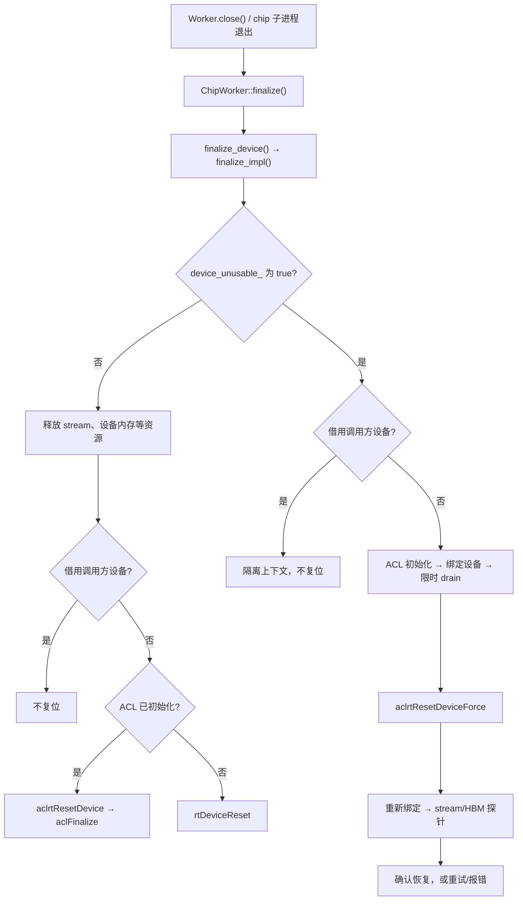

# simpler 的 CANN 复位机制

本文梳理 onboard 设备上下文的收尾流程。**复位发生在 `ChipWorker::finalize()`，不是每次 `run()` 后，也不要求整个进程退出。**相关超时机制见 [SyncStream 超时机制](../性能诊断/SyncStream超时机制.md)。

## 1. 谁触发复位

L2 直接收尾自己的 `ChipWorker`。L3 则按 `device_ids` 为每个 L2 创建一个 chip 子进程；关闭 L3 时，每个子进程各自收尾。因此两个正常运行的 L2 通常会分别调用一次 reset，L3 父进程不会统一复位。初始化未完成或设备未绑定时，实际调用次数可能更少。[L3 创建与收尾](../../../python/simpler/worker.py)（约 9384–9443、4300–4340、14390–14415 行）

对自有设备的 Program 模式，`device_unusable_ == true` 表示该 runner 已被标记为不可用，收尾时**尝试强制复位**；`false` 表示未触发故障路径，正常收尾通常仍会**调用常规复位**。AICore 启动或运行完成失败会设置此标记并拒绝后续任务；限时 device drain 即使成功，也不能取消标记。[a2a3 故障标记](../../../src/a2a3/platform/onboard/host/device_runner.cpp)（约 1077–1118 行）

## 2. `finalize_impl()` 如何选择 API

基类 `DeviceRunnerBase::finalize()` 只检查上下文，然后调用子类的 `finalize_impl()`。**直接读取 `device_unusable_` 的是子类实现**：a2a3 第 1358 行、a5 第 1234 行。条件为真进入故障分支并在末尾 `return`；否则继续执行下方的正常分支。故障标记由运行错误后的 `recover_device_or_mark_unusable()` 设为 `true`。[基类入口](../../../src/common/platform/onboard/host/device_runner_base.cpp)（约 1650 行） · [a2a3 分支](../../../src/a2a3/platform/onboard/host/device_runner.cpp)（约 1077、1353–1481 行） · [a5 分支](../../../src/a5/platform/onboard/host/device_runner.cpp)（约 1017、1230–1325 行）

| 情况 | 处理 |
| ---- | ---- |
| 故障、Program 模式 | `attempt_fatal_reset()` 重试调用 `force_reset_device()`；后者执行 `aclrtResetDeviceForce` 和恢复探针，然后返回 |
| 故障、Kernel 模式 | 不复位借用的设备，隔离本上下文 |
| 正常、Program 模式、`acl_ready_ == true` | 释放资源后调用 `aclrtResetDevice`，再调用 `aclFinalize` |
| 正常、Program 模式、`acl_ready_ == false` | 释放资源后调用 `rtDeviceReset` |
| 正常、Kernel 模式 | 只释放本上下文资源，不复位调用方设备 |

三个 reset API 的作用：

| API | 作用 | simpler 中的用途 |
| --- | ---- | ---------------- |
| `rtDeviceReset` | 从 RTS 层释放设备运行时状态 | 未初始化 ACL 时的正常收尾 |
| `aclrtResetDevice` | 从 ACL 层释放设备绑定及其资源 | 已初始化 ACL 时的正常收尾；也用于清理故障路径中的临时绑定 |
| `aclrtResetDeviceForce` | 强制释放默认 Context、Stream 等资源 | 故障收尾中尝试清除粘滞错误；随后还要做恢复探针 |

正常路径必须在 reset 前释放 stream 和设备内存，避免析构时访问已失效的上下文。若仍有未释放的诊断资源，可能提前返回而不执行 reset。**常规 reset 返回 0 只表示接口调用成功**，没有恢复探针；多个设备引用存在时，普通 reset 还可能只减少一次引用。[a2a3 分支](../../../src/a2a3/platform/onboard/host/device_runner.cpp)（约 1353–1590 行） · [a5 分支](../../../src/a5/platform/onboard/host/device_runner.cpp)（约 1230–1400 行） · [公共收尾](../../../src/common/platform/onboard/host/device_runner_base.cpp)（约 2855–2885 行） · [SDMA 调查](../../../docs/investigations/2026-07-a2a3-sdma-fault-teardown.md)

故障分支还会临时调用 `aclrtSetDevice`。清理这个绑定的 `DeviceBindGuard` 析构时可能调用 `aclrtResetDevice`；这是绑定清理，不表示又进入正常分支。`aclFinalize` 用于 ACL 收尾，也不是 reset API。[a2a3 绑定守卫](../../../src/a2a3/platform/onboard/host/device_runner.cpp)（约 1157–1191 行） · [a5 绑定守卫](../../../src/a5/platform/onboard/host/device_runner.cpp)（约 1101–1128 行）

Worker 的 onboard 复位调用集中在 a2a3/a5 两套 `DeviceRunner` 的上述位置。仓库另有独立的 [core swimlane 回放工具](../../../simpler_setup/tools/core_swimlane.py)和 `tools/cann-examples/` 示例，它们自行调用 reset 收尾，不属于 `DeviceRunner::finalize_impl()` 的流程。

## 3. 故障收尾

Program 模式发生故障时，收尾流程停止采集器，跳过坏设备上的逐项释放，然后：

1. `AclInitGuard` 确保 ACL 可用；`DeviceBindGuard` 将当前线程绑定到目标设备。这样限时 drain 和强制复位都在有效的 ACL/设备上下文中执行。
2. 限时 drain 后调用 `aclrtResetDeviceForce`；drain 结果不阻止强制复位。强制复位会使原绑定上下文失效，因此重新绑定后才创建/销毁 stream、分配/释放 64 字节 HBM。探针全部成功才确认设备可用。
3. 放弃旧设备代的句柄；只有探针通过才清除故障标记。旧设备地址不可复用。

守卫只清理由自己建立的 ACL 状态和设备绑定，避免引用泄漏。这里的绑定服务于整段 drain、reset、探针流程；[CANN 文档](https://www.hiascend.com/doc_center/source/zh/CANNCommunityEdition/910beta2/API/runtimeapi/aclcppdevg_03_0041.html)允许 `aclrtResetDeviceForce` 与 `aclrtSetDevice` 不逐次配对。[守卫实现](../../../src/a2a3/platform/onboard/host/device_runner.cpp)（约 1125–1191 行）

`attempt_fatal_reset()` 是 simpler 的重试辅助函数，**不是 CANN API**：通常最多调用 `force_reset_device()` **3 次**；持有 SDMA workspace 时只调用 **1 次**。a2a3 的 SDMA 故障路径还会在复位前等待一段时间，以规避特定 CANN/驱动组合的资源释放问题。[重试辅助函数](../../../src/common/utils/fatal_shutdown_latch.h) · [强制复位与探针](../../../src/a2a3/platform/onboard/host/device_runner.cpp)（约 1193–1297 行） · [故障收尾调用点](../../../src/a2a3/platform/onboard/host/device_runner.cpp)（约 1404–1418 行） · [a5 对应实现](../../../src/a5/platform/onboard/host/device_runner.cpp)（约 1129–1320 行）

探针未通过时返回错误；若此前启用了 ACL，也跳过可能碰触坏资源的 `aclFinalize()`。Kernel 模式借用设备，故障时由调用方负责恢复。[Kernel 模式边界](../../../src/a2a3/platform/onboard/host/device_runner.cpp)（约 1077–1085、1193–1205、1404–1465 行）

## 4. 怎样看复位结果

目前只有 a2a3 onboard `host_build_graph` 发布 `Worker.teardown_reports()`。L3 的报告按 chip 子进程 PID 区分：没有键表示子进程未回收，`committed == false` 表示没有有效记录，不能据此断定没有复位。[报告 API](../../../python/simpler/worker.py)（约 12799 行） · [运行时开关](../../../src/a2a3/runtime/host_build_graph/host/runtime_maker.cpp)（约 150 行）

| 记录 | 含义 |
| ---- | ---- |
| `NORMAL` + `API_OK_NO_PROBE` | 常规 reset 返回 0，未检查设备可用性 |
| `FATAL` + `probe_confirmed` | 强制 reset 后的 stream/HBM 探针通过 |
| `PREAMBLE_FAILED` | 最后一次尝试未进入 reset API；此前是否调用过要看 `reset_api_invocations_total` |
| `REFUSED` | Kernel 模式因设备所有权拒绝复位 |

报告只记录收尾观察结果，不能证明设备上所有工作都已停止。其他运行时可查 Host 日志中的 `force_reset_device`、`aclrtResetDevice`、`rtDeviceReset` 和错误码。[报告字段](../../../python/simpler/teardown_report.py)
