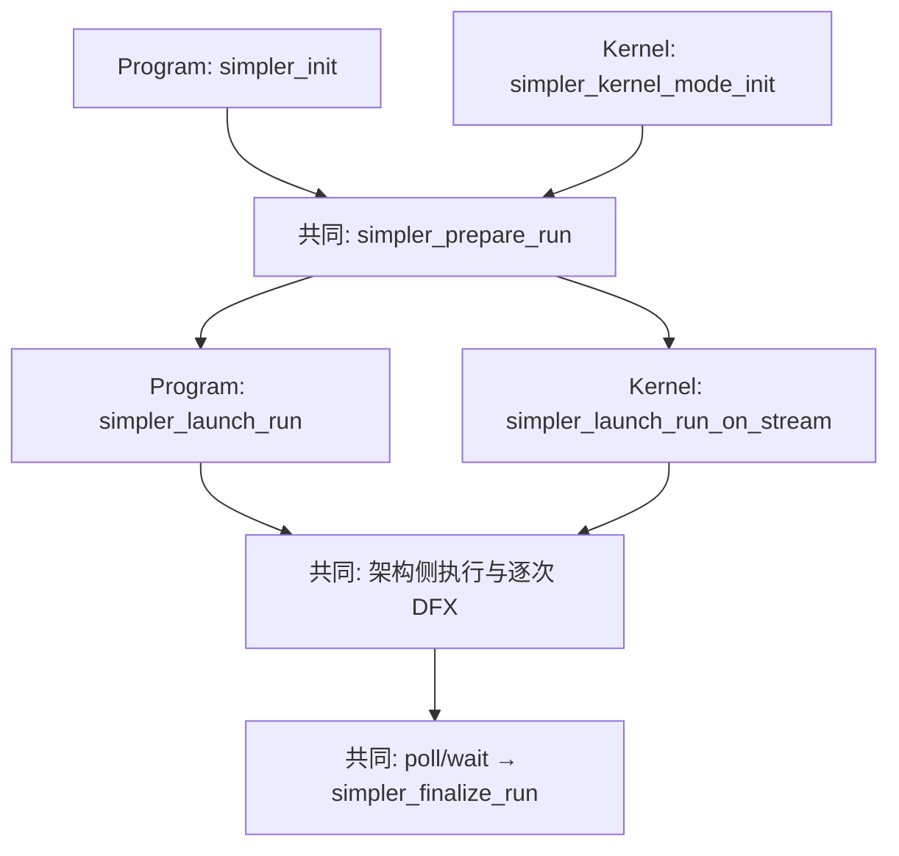

# Simpler 的 Kernel 模式

这里的 Kernel 模式指 **Simpler 嵌入调用方运行环境、按 callable 提交任务**。调用方提供设备、RTS context、stream 和张量地址；Simpler 仍负责注册 callable、准备参数、管理内部 stream 与事件，并调度设备任务。

| 比较项 | Program 模式 | Kernel 模式 |
| ------ | ------------ | ----------- |
| 设备与 stream | Simpler 创建和管理 | 调用方持有；Simpler 借用并接入调用方 stream |
| 提交 | `simpler_launch_run` | 当前 main 的逐次路径使用 `simpler_launch_run_on_stream` |
| 关闭 | 释放 Simpler 管理的设备资源 | 释放 Simpler context 资源，保留调用方的设备、context 和 stream |

## 当前 main 的共同逐次路径

公开 Python 路径是 `Worker.init(borrowed_context_generation=...)` 后调用 `Worker.submit(..., caller_stream=...)`。该路径每次调用都经过 host 的准备、提交和完成处理，因此可按本次 `CallConfig` 采集并导出 DFX。它是 **native eager 逐次执行**；图 replay 不会重新执行这些 host 步骤。

## 专用 Kernel launch 与图捕获

按上游 main `b24bfc187`（2026-10-23）核对，`simpler_kernel_mode_supported()` 返回 0，`simpler_kernel_mode_launch()` 尚未开放。仓库的内部 stream 捕获探针能在 A2A3 上重复提交示例 kernel，但不构成完整 callable 与 DFX 的公开图路径。[C API 入口](../../../src/common/platform/onboard/host/c_api_shared.cpp) · [捕获探针](../../../tests/st/a2a3/kernel_capture/test_kernel_capture.py)

专用路径的工作正在 [Kernel 模式集成分支](https://github.com/hw-native-sys/simpler/tree/feat/kernel-mode-integration-test) 和若干待合入 main 的 PR 中进行。DFX 的现状、已有实现和剩余验收见[#2202 临时方案](Kernel模式DFX改造临时方案.md)；本地逐次执行的真机证据见[验证记录](Kernel模式DFX用户路径真机验证.md)。
